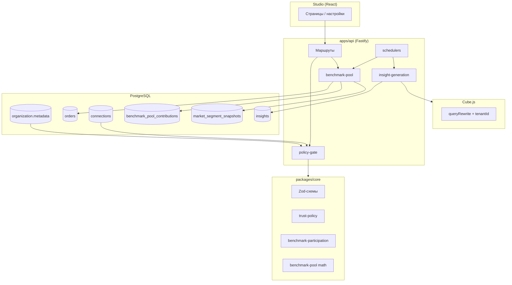
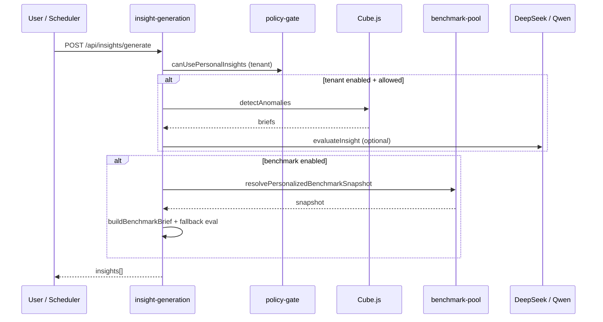
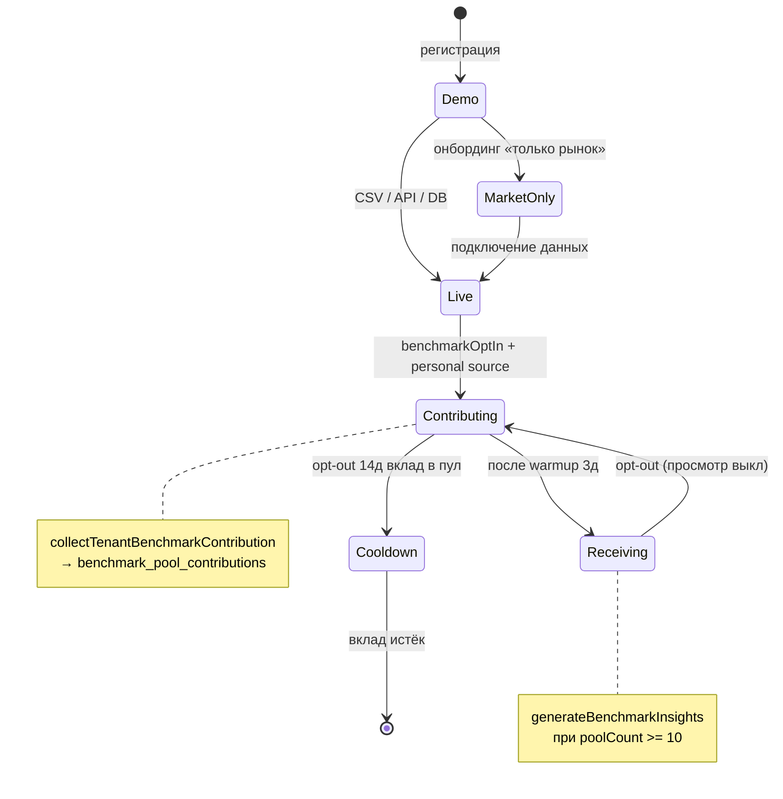

# Логика бэкенда Sellerpool (Селлерпул)

Документ описывает **как сервис работает под капотом**: слои данных, политику доступа, бенчмарк-пул, инсайты и **запланированные алгоритмы** выборок.  
Актуально для `apps/api`, `packages/core`, `packages/insights`, worker.

---

## 1. Карта слоёв



| Слой | Роль | Ключевые модули |
|------|------|-----------------|
| **Маршруты** | HTTP, auth, RBAC | `routes/*.ts`, `request-auth.ts` |
| **Policy gate** | Единая проверка политики | `policy-gate.ts` |
| **Данные org** | Настройки в JSON metadata | `org-metadata.ts` |
| **Бенчмарк-пул** | Сбор и агрегация вкладов | `benchmark-pool.ts` |
| **Инсайты** | tenant / market / benchmark | `insight-generation.ts`, `packages/insights` |
| **Планировщики** | Фоновые job | `insight-scheduler.ts`, `benchmark-pool-scheduler.ts` |
| **Аналитика** | Запросы с изоляцией tenant | Cube JWT + `cube/cube.js` |

---

## 2. Сетка таблиц и хранилищ

### 2.1. Реляционные таблицы (аналитика и политика)

| Таблица | Назначение | Ключевые поля | Связь с политикой |
|---------|------------|---------------|-------------------|
| `organization` | Org + billing + **metadata JSON** | `metadata.privacySettings`, `metadata.insightSettings` | Opt-in бенчмарков, категория |
| `connections` | Источники данных | `kind`, `method`, `credentials_enc`, `config` | Путь подключения (API/CSV/DB) |
| `orders` | Сырые продажи tenant (импорт/sync) | `tenant_id`, `amount`, `created_at` | **Не** уходит в пул; только агрегаты |
| `benchmark_pool_contributions` | Вклад в пул (1 строка / org / категория) | `revenue`, `order_count`, `*_prev`, `collected_at` | Обезличенные сводки |
| `market_segment_snapshots` | Снимки рынка и бенчмарка | `segment_type`, `category`, `payload` JSON | Публичные/пуловые агрегаты |
| `insights` | Сгенерированные инсайты | `source`: tenant \| market \| benchmark | Разные gate по source |
| `insight_runs` | Журнал запусков AI | `trigger`, `credits_used` | Учёт лимитов |

### 2.2. Metadata org (не отдельная таблица)

| Ключ в `organization.metadata` | Схема | Что влияет |
|--------------------------------|-------|------------|
| `privacySettings` | `PrivacySettings` | `benchmarkOptIn`, `marketCategory`, warmup/cooldown |
| `insightSettings` | `InsightSettings` | `sources.tenant/market/benchmark`, метрики, расписание |
| `planId` | billing | Pro/Enterprise для бенчмарков |
| `lastInsightScheduleAt` | ISO datetime | Планировщик инсайтов |

### 2.3. Матрица «кто что читает / пишет»

| Операция | orders | benchmark_pool_contributions | market_segment_snapshots | insights |
|----------|:------:|:----------------------------:|:------------------------:|:--------:|
| CSV / API import | **W** | — | — | — |
| `collectTenantBenchmarkContribution` | **R** агрегат | **W** upsert | — | — |
| `refreshBenchmarkSegmentSnapshot` | — | **R** | **W** upsert | — |
| `generateTenantInsights` | — (через Cube) | — | — | **W** |
| `generateBenchmarkInsights` | — | **R** | **R** (fallback dev) | **W** |
| `GET /api/insights` | — | — | — | **R** + gate |
| Другой tenant | **нет** | **нет** | только агрегаты категории | **нет** |

---

## 3. Политика сервиса → код

### 3.1. Пути подключения данных

| Путь (`DataContributionPath`) | Условие | `dataMode` | Capabilities |
|---------------------------------|---------|------------|--------------|
| `none` | Нет connections | `demo` | Только market (+ демо-дашборды) |
| `market_only` | Нет личного источника | `demo` | market |
| `file_import` | CSV/Excel | `live` | + personal dashboards/insights |
| `marketplace_api` | API WB/Ozon | `live` | + `autoRefresh` |
| `database` | Read-only БД | `live` | + `autoRefresh` |

Источник правды: `packages/core/src/trust-policy.ts` → `getTrustCapabilities()`.

### 3.2. Policy gate (enforcement)

| Проверка | Где enforced | Ошибка / поведение |
|----------|--------------|-------------------|
| Личный источник для tenant-инсайтов | `insight-generation`, `PATCH insights/settings`, `GET insights` | `PERSONAL_INSIGHTS_REQUIRES_SOURCE` |
| Личный источник для opt-in в пул | `PATCH /api/privacy` | `BENCHMARK_OPT_IN_REQUIRES_PERSONAL_SOURCE` |
| Бенчмарк только Pro/Enterprise | `benchmark-insight-generation` | Пустой результат |
| Прогрев 3 дня | `canReceiveBenchmarkParticipation` | Инсайты скрыты, вклад в пул идёт |
| Cooldown 14 дней после opt-out | `isBenchmarkContributor` | Агрегаты ещё в пуле |
| Benchmark в списке/деталке | `GET /api/insights`, `GET /api/insights/:id` | Фильтр / 403 |

Точка сборки контекста: `apps/api/src/lib/policy-gate.ts` → `getOrgPolicyContext()`.

---

## 4. Бенчмарк-пул: текущий алгоритм

### 4.1. Константы

| Константа | Значение | Файл |
|-----------|----------|------|
| `BENCHMARK_WARMUP_DAYS` | 3 | `benchmark-participation.ts` |
| `BENCHMARK_OPT_OUT_COOLDOWN_DAYS` | 14 | `benchmark-participation.ts` |
| `BENCHMARK_MIN_PARTICIPANTS` | 10 | `packages/insights` |
| `BENCHMARK_POOL_STALE_DAYS` | 7 | `benchmark-pool.ts` |
| Окно метрик | 30 + 30 дней | `benchmark-pool.ts` |

### 4.2. Кто попадает в выборку вкладов

```
ДЛЯ КАЖДОЙ organization:
  privacy ← getPrivacySettings(org)
  connections ← getOrgConnectionProfile(org)

  ЕСЛИ НЕ isBenchmarkContributor(privacy): ПРОПУСТИТЬ
  ЕСЛИ НЕ hasPersonalDataSource(connections): ПРОПУСТИТЬ

  current  ← SUM(orders) за [now-30d, now)
  previous ← SUM(orders) за [now-60d, now-30d)

  ЕСЛИ current.orderCount = 0 И previous.orderCount = 0: ПРОПУСТИТЬ

  UPSERT benchmark_pool_contributions
    (organization_id, category = privacy.marketCategory)
```

**В пул не попадают:** SKU, id заказов, покупатели, сырые строки — только 4 числа + метка периода.

### 4.3. Агрегация по категории (k-anonymity)

```
ДЛЯ КАЖДОЙ category:
  rows ← contributions WHERE category = C
                         AND collected_at >= now - 7d

  n ← count(rows)
  ЕСЛИ n = 0: не обновлять снимок

  avgOrderValues[i] ← revenue[i] / order_count[i]  (где order_count > 0)
  pool.medianAvgOrderValue ← median(avgOrderValues)
  pool.medianRevenueChangePct ← median(revenueChange по org)

  UPSERT market_segment_snapshots
    segment_type = 'benchmark', payload = category snapshot
```

### 4.4. Персонализация инсайта для org

| Шаг | Формула / логика |
|-----|------------------|
| Средний чек org | `revenue / order_count` за текущие 30д |
| Δ среднего чека | `avgOrderValueChangePct(current, previous)` |
| Медиана пула | `median(avgOrderValues всех участников)` |
| Перцентиль | `benchmarkPercentileLabel(yourAvg, pool.avgOrderValues)` |
| Severity | low &lt; 8% &lt; medium &lt; 15% &lt; high |
| Текст инсайта | `buildBenchmarkFallbackEvaluation` + meta snapshot |

### 4.5. Gate генерации benchmark-инсайта

```
poolCount ← countActivePoolContributors(category)

ЕСЛИ poolCount >= BENCHMARK_MIN_PARTICIPANTS (10):
  snapshot ← resolvePersonalizedBenchmarkSnapshot(org, category)
  ЕСЛИ snapshot: сгенерировать инсайт

ИНАЧЕ ЕСЛИ NODE_ENV !== 'production':
  snapshot ← seed из market_segment_snapshots (dev fallback)
ИНАЧЕ:
  не генерировать
```

Дополнительно: план Pro/Enterprise, `benchmarkOptIn`, прогрев, cooldown 24ч между инсайтами.

### 4.6. Расписание

| Job | Когда | Действие |
|-----|-------|----------|
| `benchmark-pool-scheduler` | 03:00 МСК ежедневно | `runBenchmarkPoolRefresh()` |
| Немедленный collect | После CSV, sync API, opt-in privacy | `queueBenchmarkContributionCollect(org)` |
| `insight-scheduler` | 09:00 МСК / каждые 12ч | `runInsightGeneration()` |

---

## 5. Инсайты: три конвейера

| Source | Источник данных | Gate | Кредиты |
|--------|-----------------|------|---------|
| **tenant** | Cube + tenant JWT | personal source + metrics enabled | Да |
| **market** | `market_segment_snapshots` (segment_type=market) | `sources.market` | Нет |
| **benchmark** | Пул + персонализация | plan + opt-in + warmup + pool ≥ 10 | Нет |



---

## 6. Изоляция и безопасность

| Механизм | Реализация |
|----------|------------|
| Tenant в Cube | JWT `tenantId` + `queryRewrite` → filter `*.tenantId` |
| Credentials | AES-256-GCM, `connection-crypto.ts` |
| CSV на диске | Не сохраняется (буфер в памяти) |
| Строки orders | В Postgres tenant-scoped; в пул — только SUM/COUNT |
| Cross-tenant read | Запрещён на уровне API и Cube |

---

## 7. Будущие алгоритмы выборок (roadmap)

### 7.1. Расширение метрик пула

| Метрика | Источник (план) | Агрегат в пул | k-min |
|---------|-----------------|---------------|-------|
| Средний чек | `orders` | median, p25, p75 | 10 ✅ сейчас |
| Выручка 30д | `orders` / Cube | median, YoY | 10 |
| Маржа % | Cube `Orders.margin` | median | 15 |
| Конверсия | Cube / MP API | median | 20 |
| Доля возвратов | Cube | median | 15 |

### 7.2. Стратифицированная выборка (план)

Чтобы ниша не искажалась крупными селлерами:

| Страта | Критерий | Квота в снимке |
|--------|----------|----------------|
| S | выручка &lt; 500k ₽/мес | 40% |
| M | 500k – 5M | 40% |
| L | &gt; 5M | 20% |

```
ДЛЯ КАЖДОЙ stratum S:
  sample ← случайная подвыборка contributors (min 3 на страту)
  stratum_median ← median(metric в sample)
pool_median ← weighted_median(stratum_medians, quotas)
```

### 7.3. Сезонность и тренды (план)

| Окно | Использование |
|------|---------------|
| 7д vs 7д | Алерты «всплеск ниши» |
| 30д vs 30д | Текущий бенчмарк ✅ |
| 90д скользящее | Сезонный индекс категории |
| YoY | Рынок + бенчмарк для «Дом и текстиль» и др. |

### 7.4. Качество выборки (план)

| Сигнал | Порог | Действие |
|--------|-------|----------|
| `collected_at` старше 7д | stale | Не учитывать в poolCount |
| `order_count` &lt; 10 за 30д | low volume | Пометка `completeness ↓`, не влиять на перцентиль |
| Выброс &gt; 3σ от медианы | outlier | Winsorize или исключить из median |
| n &lt; k-min | недостаточно | Не показывать benchmark-инсайт (prod) |

### 7.5. Планируемые таблицы

| Таблица (будущее) | Назначение |
|-------------------|------------|
| `benchmark_pool_metric_series` | Временные ряды агрегатов по категории (день/неделя) |
| `benchmark_pool_strata` | Метаданные страты org (обновляется monthly) |
| `market_signal_events` | Инфоповоды / всплески для «тренд ниши» |

---

## 8. Сетка API ↔ бизнес-правила

| Endpoint | Метод | Правило |
|----------|-------|---------|
| `/api/me` | GET | `dataMode`, `trustCapabilities` |
| `/api/privacy` | GET/PATCH | `trustPolicy`, opt-in gate |
| `/api/insights` | GET | Фильтр tenant/benchmark по gate |
| `/api/insights/:id` | GET | 403 если нет прав на source |
| `/api/insights/generate` | POST | Полный pipeline + credits |
| `/api/insights/settings` | PATCH | Синхронизация benchmark ↔ privacy |
| `/api/connections/csv` | POST | import → `queueBenchmarkContributionCollect` |
| `/api/connections/:id/sync` | POST | sync → collect |

---

## 9. Файловый указатель

| Тема | Путь |
|------|------|
| Участие в пуле (warmup/cooldown) | `packages/core/src/benchmark-participation.ts` |
| Математика пула | `packages/core/src/benchmark-pool.ts` |
| Политика и capabilities | `packages/core/src/trust-policy.ts` |
| Сбор и refresh пула | `apps/api/src/lib/benchmark-pool.ts` |
| Policy enforcement | `apps/api/src/lib/policy-gate.ts` |
| Генерация benchmark-инсайтов | `apps/api/src/lib/benchmark-insight-generation.ts` |
| Снимки сегментов | `apps/api/src/lib/market-aggregates.ts` |
| Планировщик пула | `apps/api/src/lib/benchmark-pool-scheduler.ts` |
| Схема вкладов | `apps/api/src/db/benchmark-pool.ts` |
| Tenant isolation Cube | `cube/cube.js` |

---

## 10. Диаграмма жизненного цикла данных селлера



---

*Документ отражает код на момент внедрения бенчмарк-пула и policy-gate. Секция 7 — целевая архитектура выборок, не всё реализовано.*
